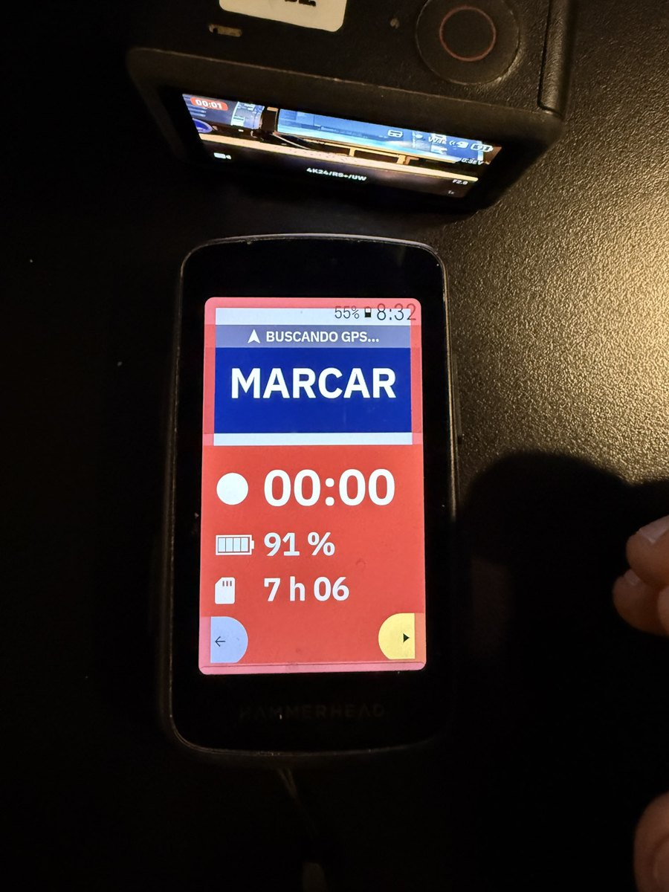
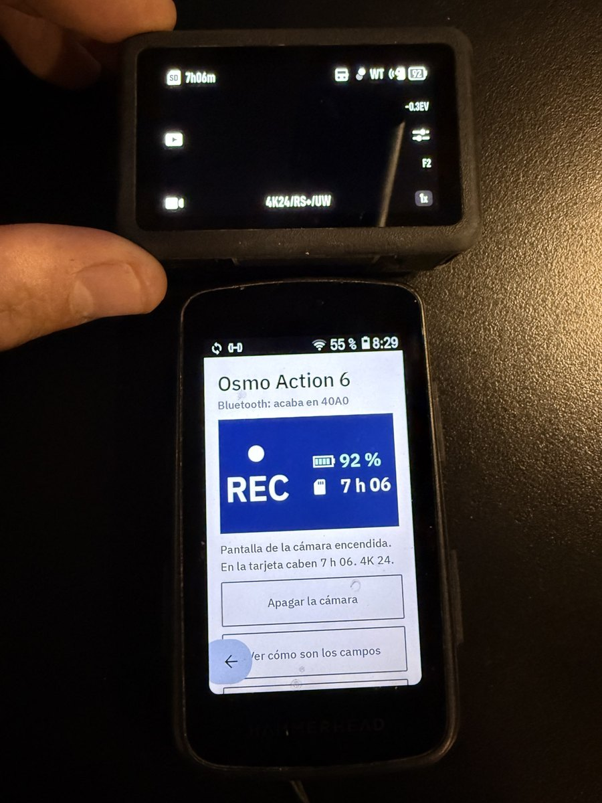
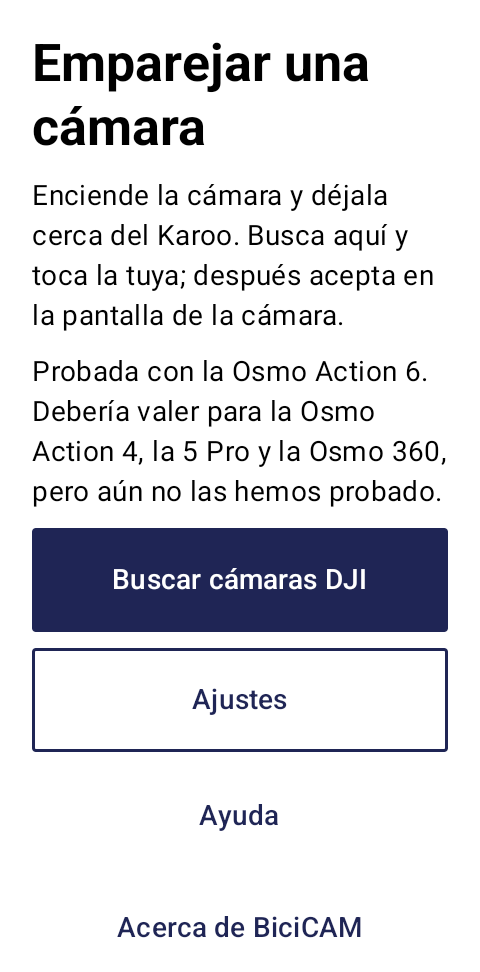
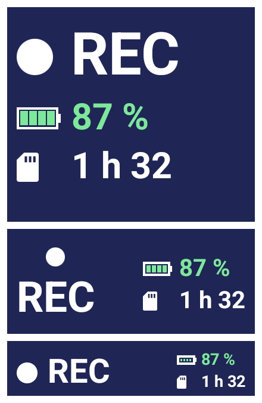
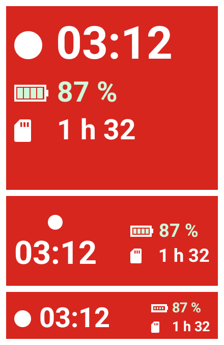
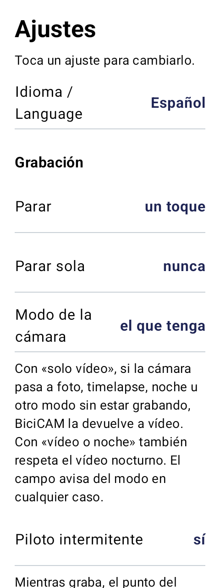

# BiciCAM

Maneja tu DJI Osmo Action desde el Hammerhead Karoo: empieza y para la grabación, mira su batería y lo que le queda de tarjeta, deja marcadores y ten un marco rojo alrededor de la pantalla mientras graba.

Gratis y de código abierto, hecha por [BiciLAB](https://www.bicilab.es/), medio de ciclismo.

[Read in English](README.md)

<p align="center">
  
  
</p>

## Cámaras compatibles

| Cámara | Estado |
|---|---|
| DJI Osmo Action 6 | Probada con BiciCAM 0.6.0 en un Karoo 3 en rutas reales, el 13 de noviembre de 2026 (software del Karoo 1.669.2569) y el 22 de noviembre de 2026 (tres horas de reconocimiento de una carrera): emparejar, grabar y parar, apagar, batería, tarjeta, marcadores, GPS, parada automática y reconexión sola tras perder la señal o al volver a encender la cámara. Aún sin probar en la bici: «Ahorro de batería» y las acciones para los botones de SRAM AXS. |
| DJI Osmo Action 4, 5 Pro y Osmo 360 | Deberían funcionar: usan el mismo protocolo que DJI publica para su mando GPS. Sin probar. |

Un límite que conviene saber antes de instalarla: **una cámara DJI no se puede encender desde el Karoo.** El Karoo puede apagarla, pero las DJI solo despiertan con su propio mando. Pulsa el botón de la cámara y BiciCAM conecta sola. Si quieres poder grabar en cualquier momento de la ruta, pon el apagado automático de la cámara en «Nunca». La cámara gastará más batería mientras espera.

**Insta360 y GoPro, todavía no.** El código para las dos está en el proyecto, pero apagado en esta versión. Con una Insta360 Ace Pro 2 (13 de noviembre de 2026) el Karoo graba, para y apaga la cámara, pero la cámara no vuelve a conectar después de un corte. GoPro (protocolo Open GoPro) no se ha probado con ninguna cámara. Si quieres echar una mano, [abre un aviso](https://github.com/apradoperez/bicicam/issues/new/choose).

## Qué necesitas

- Un Hammerhead Karoo que admita extensiones.
- Para instalar con el enlace: según Hammerhead, la versión 1.538 o posterior del Karoo y la versión 1.36 (Android) o 1.12 (iPhone) o posterior de la app Hammerhead Companion. Los detalles, en la [guía de Hammerhead](https://support.hammerhead.io/hc/en-us/articles/31576497036827-Companion-App-Sideloading) (en inglés).
- Una DJI Osmo Action (mira la tabla de arriba).

## Instalar

En el móvil, deja pulsado este enlace y compártelo con la app **Hammerhead Companion**: [bicicam.apk](https://github.com/apradoperez/bicicam/releases/latest/download/bicicam.apk). El Karoo lo descarga y enseña la pantalla de **Instalar**; tócala.

Si el Karoo da un error al instalar, vuelve a compartir el enlace (no compartas un archivo a medio descargar).

Después, BiciCAM aparece en **Extensiones** y el Karoo te avisa cuando hay una versión nueva. Qué trae cada versión: [registro de cambios](CHANGELOG.md).

Con ordenador: en el Karoo activa las opciones de desarrollador y la depuración USB, conéctalo por USB-C, descarga el APK de la [página de versiones](https://github.com/apradoperez/bicicam/releases/latest) y ejecuta `adb install bicicam.apk`.

Permisos: Bluetooth (en Android 11 o anterior, Android lo llama ubicación), mostrarse sobre otras apps (para el marco rojo) y los que añade la biblioteca de Android para tareas en segundo plano (estado de la red, arranque, mantener despierto). No pide internet.

## Puesta en marcha

1. En el Karoo abre **Extensiones**, luego **BiciCAM**, y da el permiso de Bluetooth.
2. Enciende la cámara, toca **Buscar cámaras DJI** y toca la tuya. La cámara tiene que enseñar un código de cuatro cifras, el mismo que enseña BiciCAM. Si coincide, acéptalo en la cámara.
3. Añade los campos de BiciCAM que quieras a una página de datos de tu perfil.

<p align="center">
  
</p>

## Campos

El campo entero es el botón. El color dice el estado: azul marino, lista; rojo, grabando; ámbar, pide tu atención; gris claro, ahora no está disponible. La batería de la cámara pasa de verde (30 % o más) a amarillo (del 15 al 29 %) y a rojo.

| Campo | Qué hace |
|---|---|
| Cámara: REC, batería y tarjeta | Todo en un campo: REC o el tiempo de grabación, la batería de la cámara y lo que cabe en la tarjeta. En un hueco alto van en tres filas; en uno normal, REC a la izquierda y la batería sobre la tarjeta a la derecha. Un toque empieza; un toque para (o dos, según los ajustes). |
| Cámara: REC | Un toque empieza. Un toque para (o dos, según los ajustes). Enseña el tiempo de grabación. |
| Cámara: REC y batería (estrecho) | Lo mismo, con la batería de la cámara en grande debajo. Para campos de media anchura. |
| Cámara: REC y batería (ancho) | REC a la izquierda y la batería a la derecha. Para campos de lado a lado. |
| Cámara: batería | Batería de la cámara, y si su pantalla está encendida. |
| Cámara: encender y apagar | Enseña si la cámara está encendida. Dos toques la apagan. La cámara se enciende con su propio botón. |
| Cámara: tarjeta | Tiempo de vídeo que cabe aún en la tarjeta, con el modo en que está. |
| Cámara: marcador | Un toque deja un marcador en el vídeo que se está grabando. |

Dos avisos que salen en el propio campo de REC, en ámbar:

- **La cámara no está en vídeo.** Si está en foto, timelapse, cámara lenta u otro modo, el campo lo dice con su dibujo («FOTO», «LAPSE»...), porque ahí un toque haría una foto o empezaría otra cosa.
- **Sin señal.** Si la cámara estaba grabando y deja de dar señales sin soltar el Bluetooth, el campo deja de contar y el marco rojo se quita: no se sabe si sigue grabando, y hay que mirarla.

<p align="center">
  
  
</p>

Hay además dos acciones, **Cámara: REC** y **Cámara: marcador**, que se pueden asignar a los botones de un mando emparejado, como las manetas SRAM AXS.

## Ajustes

<p align="center">
  
</p>

- **Idioma:** español o inglés.
- **Parar:** con un toque (de fábrica) o con dos.
- **Parar sola:** nunca (de fábrica), o a los 3, 6 o 9 minutos.
- **Modo de la cámara:** «el que tenga» (de fábrica), «solo vídeo» o «vídeo o noche». Con «solo vídeo», si la cámara pasa a foto, timelapse, noche u otro modo sin estar grabando, BiciCAM la devuelve a vídeo; con «vídeo o noche» también respeta el vídeo nocturno. Nunca corta una grabación.
- **Piloto intermitente:** activado de fábrica. Mientras graba, el punto del campo parpadea cada segundo.
- **Avisos durante la ruta:** batería de la cámara baja (20 % y 10 %), tarjeta casi llena (menos de 10 minutos) y grabación parada sin que la pares. Todos activados de fábrica.
- **Marco rojo:** activado de fábrica en cuanto das el permiso de mostrarse sobre otras apps, que BiciCAM pide. Tres grosores: 5, 10 o 13.
- **GPS a la cámara:** activado de fábrica. Mira Privacidad.
- **Clips en la ruta:** desactivado de fábrica. Apunta en el archivo de la ruta del Karoo cuándo grabó la cámara y cada marcador. Aún sin probar.
- **Ahorro de batería:** desactivado de fábrica. El GPS solo se manda a la cámara mientras graba; el primer segundo de cada clip puede quedar sin posición.
- **Apagarla sin grabar:** nunca (de fábrica), o a los 2, 5, 10 o 15 minutos. Con DJI, solo el botón de la cámara la vuelve a encender.

## Marcadores y GPS en tu vídeo

En las DJI, el marcador queda guardado dentro del archivo de vídeo. Se puede leer con [exiftool](https://exiftool.org/):

```
exiftool -HighlightMarkers tu-clip.MP4
```

`tools/dji_markers.py` los pasa a un archivo CSV (las columnas salen en inglés). La cámara redondea los marcadores a una rejilla de 3 segundos.

Con el GPS activado, la cámara guarda en cada fotograma la posición y la hora del Karoo, así que después se puede casar cada clip con el archivo de la ruta. Dos cosas que conviene saber: si el enlace Bluetooth se corta en mitad de un clip, la cámara repite la última posición y hora que recibió; y los clips grabados con BiciCAM 0.5.0 llevan la hora 7 horas por delante de UTC (corregido en la 0.6.0 y comprobado con una Osmo Action 6).

## Dudas

### Los campos se quedan en «Esperando»

BiciCAM está buscando la cámara. Comprueba que está encendida y cerca. Las cámaras solo atienden a un aparato a la vez: si la app de la cámara en tu móvil (DJI Mimo) está conectada a ella, ciérrala mientras ruedas.

### La cámara no se enciende desde el Karoo

Con las DJI es así: el Karoo puede apagarla, pero no encenderla. Pulsa el botón de la cámara y BiciCAM conecta sola en unos segundos, sin tocar nada en el Karoo.

### ¿Se para la grabación si cambio de página?

No. Mientras graba, BiciCAM no suelta la cámara aunque cambies de página. Sin grabar, la suelta dos minutos después de dejar de ver sus campos.

### ¿Por qué se ha apagado la cámara?

Si has puesto «Apagarla sin grabar», BiciCAM apaga la cámara cuando pasa ese tiempo sin grabar, para ahorrarle batería. Nunca corta una grabación.

### La cámara vuelve a preguntar si acepta la conexión

Pasa si la cámara ha perdido el emparejamiento (por ejemplo, tras restablecerla). Acepta en su pantalla. Si la rechazaste sin querer, ve a Ajustes, «Olvidar esta cámara», y emparéjala de nuevo.

## Avisar de un fallo

Abre una [incidencia](https://github.com/apradoperez/bicicam/issues/new/choose) y dinos el modelo y firmware de tu cámara, el modelo y la versión de tu Karoo y qué pasó. Si puedes, adjunta el registro de eventos: en BiciCAM abre Acerca de BiciCAM y luego Registro de eventos; arriba sale dónde está el archivo. Antes, borra posiciones, números de serie y direcciones Bluetooth: las incidencias son públicas.

## Privacidad

BiciCAM no tiene acceso a internet, no lleva analítica y no manda nada a BiciLAB. Todo se queda entre tu Karoo y tu cámara. Para saber si hay versión nueva, el Karoo consulta de vez en cuando la página de BiciCAM en GitHub, que ve la dirección IP de tu Karoo como con cualquier descarga. Lo que conviene saber:

- **Tu posición dentro del vídeo.** Con «GPS a la cámara» activado (viene así de fábrica), la cámara guarda en el archivo por dónde ibas, a qué velocidad y a qué hora. Quien reciba el archivo original puede ver dónde se grabó, también de dónde saliste. Si compartes originales, apágalo en Ajustes o quita los metadatos antes. DJI Mimo lee esos datos con sus propias condiciones.
- **Bluetooth.** La posición viaja por Bluetooth a la cámara sin un cifrado propio de BiciCAM, y los protocolos de mando de los fabricantes no dejan comprobar que la cámara es quien dice ser. BiciCAM solo habla con la cámara que emparejaste, reconocida por su dirección Bluetooth y por su modelo, pero alguien cercano con un aparato hecho a propósito aún podría hacerse pasar por ella.
- **Registros en el Karoo.** En la carpeta de la app se guardan un registro de eventos (pasos de conexión, batería, nombre, dirección Bluetooth y número de serie de tu cámara) y una lista de marcadores (hora y, si el GPS está activado, posición). Los dos tienen tope de líneas, se borran desde la app y desaparecen al desinstalarla. Si nos mandas un registro para pedir ayuda, revísalo antes: puede llevar tu posición o el número de serie de tu cámara.
- **Archivo de la ruta.** Con «Clips en la ruta» (apagado de fábrica), el archivo FIT lleva además si la cámara grababa y los marcadores. Si subes la ruta a Hammerhead o a Strava, esos datos van con ella.
- **Otras apps del Karoo.** Como pasa con cualquier extensión del Karoo, otras apps instaladas en el mismo Karoo pueden pedirle a BiciCAM que grabe, pare o deje un marcador.
- **Lo que grabas.** Si publicas tus vídeos, eres tú quien responde de las personas que salen en ellos, sobre todo si son menores. Tápalas o pide permiso.

BiciCAM la publica BiciLAB Factory SL. Dudas sobre privacidad: info@bicilab.es.

## Compilar

JDK 17 y el SDK de Android (plataforma 34).

```
./gradlew testDebugUnitTest assembleDebug
```

Las pruebas de protocolo comparan byte a byte las tramas de BiciCAM con las de ejemplo que publica DJI. Las versiones que se publican van firmadas con una clave que no está en el repositorio.

## Créditos y licencia

BiciCAM parte de [Kamerad](https://github.com/ho-tell/kamerad), de Horst Tellioglu, que hace lo mismo con las GoPro y de donde sale también la parte de GoPro, con el protocolo [Open GoPro](https://gopro.github.io/OpenGoPro/). Usa la biblioteca [karoo-ext](https://github.com/hammerheadnav/karoo-ext) de Hammerhead (licencia Apache 2.0) y el protocolo que DJI documenta en su [Osmo GPS Controller Demo](https://github.com/dji-sdk/Osmo-GPS-Controller-Demo). La parte de Insta360 sigue las notas de la comunidad sobre el mando GPS, sobre todo [insta360-ble-gps-spec](https://github.com/TheAngryRaven/insta360-ble-gps-spec).

[Licencia MIT](LICENSE). BiciCAM se entrega sin garantía: la usas bajo tu responsabilidad.

DJI, Osmo, GoPro, HERO e Insta360 son marcas de sus dueños. BiciCAM no tiene relación con DJI, GoPro, Insta360 ni Hammerhead, ni cuenta con su respaldo.
