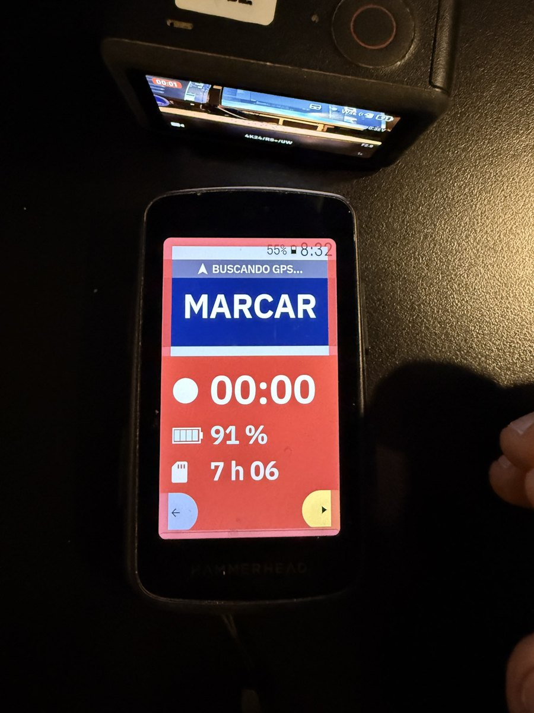
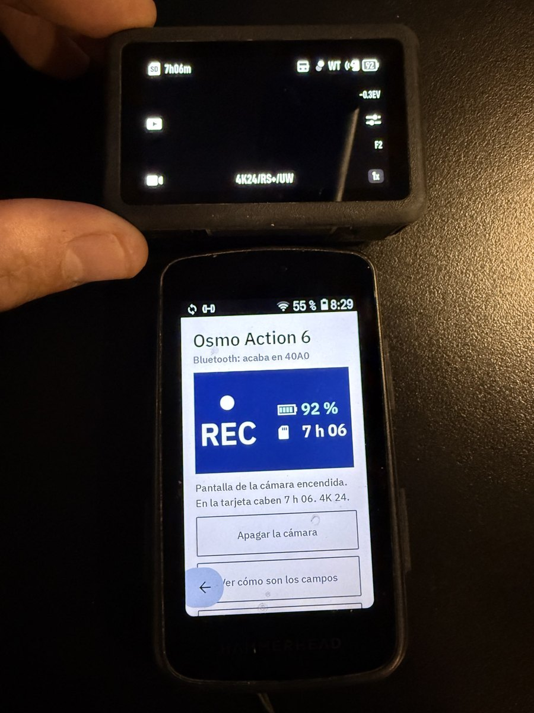
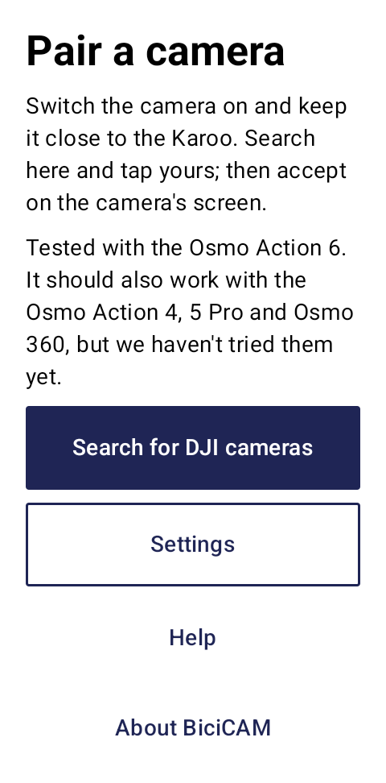
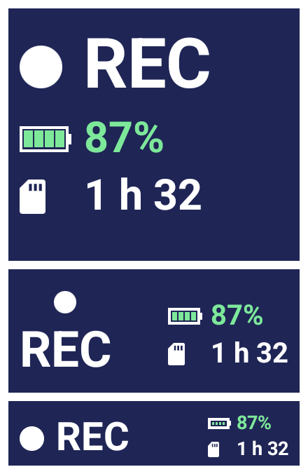
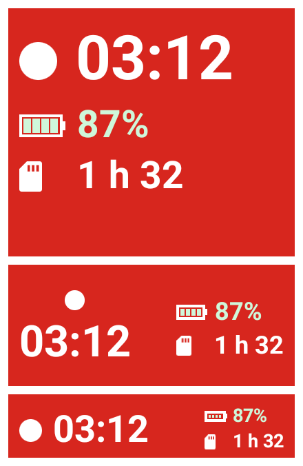
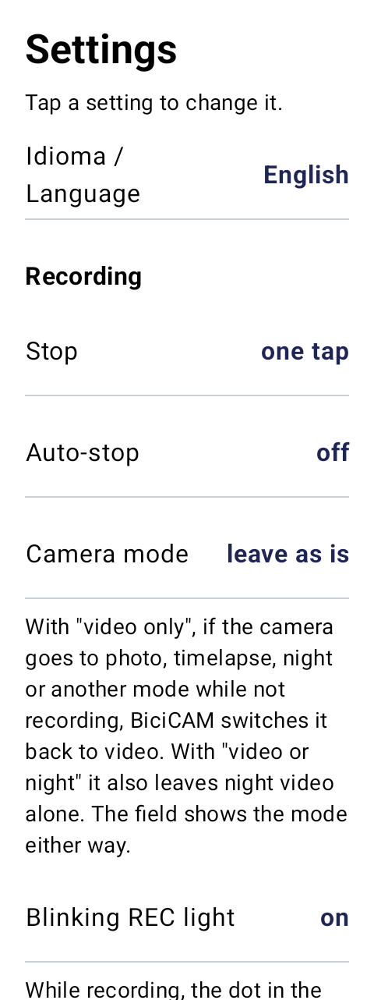

# BiciCAM

Control a DJI Osmo Action from your Hammerhead Karoo: start and stop recording, check its battery and card, drop markers, and get a red frame around the screen while it records.

Free and open source, made by [BiciLAB](https://www.bicilab.es/), a Spanish cycling media outlet.

[Leer en español](README.es.md)

<p align="center">
  
  
</p>

## Supported cameras

| Camera | Status |
|---|---|
| DJI Osmo Action 6 | Tested with BiciCAM 0.6.0 on a Karoo 3 in real rides, on 13 November 2026 (Karoo software 1.669.2569) and on 22 November 2026 (three hours of a race recce): pairing, record and stop, switch off, battery, card, markers, GPS, auto-stop and reconnecting by itself after losing the signal or switching the camera back on. Not tested on the bike yet: "Battery saver" and the SRAM AXS button actions. |
| DJI Osmo Action 4, 5 Pro, Osmo 360 | Should work: they use the same protocol DJI publishes for its GPS remote. Not tested. |

One limit you should know before installing: **a DJI camera cannot be switched on from the Karoo.** The Karoo can switch it off, but DJI cameras only wake up for their own remote. Press the camera's button and BiciCAM reconnects by itself. If you want to record at any point in the ride, set the camera's auto power-off to "Never". The camera will use more battery while it waits.

**Insta360 and GoPro, not yet.** The code for both is in the project, but switched off in this version. With an Insta360 Ace Pro 2 (13 November 2026) the Karoo starts, stops and switches the camera off, but the camera does not reconnect after the link drops. GoPro (Open GoPro protocol) has not been tested with any camera. If you want to help, [open an issue](https://github.com/apradoperez/bicicam/issues/new/choose).

## What you need

- A Hammerhead Karoo that can install extensions.
- To install from a link: according to Hammerhead, Karoo software 1.538 or later and the Hammerhead Companion App 1.36 (Android) or 1.12 (iPhone) or later. Details in [Hammerhead's sideloading guide](https://support.hammerhead.io/hc/en-us/articles/31576497036827-Companion-App-Sideloading).
- A DJI Osmo Action (see the table above).

## Install

On your phone, long-press this link and share it to the **Hammerhead Companion** app: [bicicam.apk](https://github.com/apradoperez/bicicam/releases/latest/download/bicicam.apk). The Karoo downloads it and shows an **Install** screen; tap Install.

If the Karoo shows "Unknown error", share the link again (don't share a half-downloaded file).

After that, BiciCAM appears under **Extensions**, and the Karoo tells you when there is a new version. What's new in each version: [CHANGELOG](CHANGELOG.md).

With a computer: on the Karoo enable Developer options and USB debugging, connect it by USB-C, download the APK from [Releases](https://github.com/apradoperez/bicicam/releases/latest) and run `adb install bicicam.apk`.

Permissions: Bluetooth (on Android 11 or earlier, Android calls it location), display over other apps (for the red frame) and the ones the Android library for background work adds (network state, boot, keep awake). It does not ask for internet access.

## Set up

1. On the Karoo open **Extensions**, then **BiciCAM**, and allow Bluetooth.
2. Switch the camera on, tap **Search for DJI cameras** and tap yours. The camera should show a four-digit code, the same one BiciCAM shows. If it matches, accept it on the camera.
3. Add the BiciCAM data fields you want to a data page of your ride profile.

<p align="center">
  
</p>

## Data fields

The whole field is the button. The colour tells the state: navy, ready; red, recording; amber, needs your attention; light grey, not available right now. The camera battery goes from green (30% or more) to yellow (15 to 29%) to red.

| Data field | What it does |
|---|---|
| Camera: REC, battery, card | Everything in one field: REC or the recording time, the camera battery, and the time left on the card. In a tall slot they go in three rows; in a normal one, REC on the left and the battery above the card on the right. Tap to start; tap to stop (or twice, see Settings). |
| Camera: REC | Tap to start. Tap to stop (or twice, see Settings). Shows the recording time. |
| Camera: REC + battery (narrow) | Same, with the camera battery in large type underneath. For half-width fields. |
| Camera: REC + battery (wide) | REC on the left and the battery on the right. For full-width fields. |
| Camera: battery | Camera battery, and whether its screen is on. |
| Camera: on/off | Shows whether the camera is on. Tap twice to switch it off. The camera switches on with its own button. |
| Camera: card | Recording time left on the card, and the current mode. |
| Camera: marker | Tap to drop a marker in the video being recorded. |

Two warnings show up in the REC field itself, in amber:

- **The camera is not in video.** If it is in photo, timelapse, slow motion or another mode, the field says so with its own icon ("PHOTO", "LAPSE"...), because a tap there would take a photo or start something else.
- **No signal.** If the camera was recording and goes silent without dropping Bluetooth, the field stops counting and the red frame goes away: there is no way to know whether it is still recording, so check it.

<p align="center">
  
  
</p>

There are also two actions, **Camera: REC** and **Camera: marker**, that you can assign to the buttons of a paired controller such as SRAM AXS shifters.

## Settings

<p align="center">
  
</p>

- **Language:** English or Spanish.
- **Stop:** one tap (default) or two.
- **Auto-stop:** off (default), or after 3, 6 or 9 minutes.
- **Camera mode:** "leave as is" (default), "video only" or "video or night". With "video only", if the camera goes to photo, timelapse, night or another mode while not recording, BiciCAM switches it back to video; with "video or night" it also leaves night video alone. It never cuts a recording.
- **Blinking REC light:** on by default. While recording, the dot in the field blinks every second.
- **In-ride alerts:** low camera battery (20% and 10%), card almost full (under 10 minutes), and recording stopped without you. All on by default.
- **Red frame:** on by default once you grant the "display over other apps" permission, which BiciCAM asks for. Three widths: 5, 10 or 13.
- **GPS to camera:** on by default. See Privacy.
- **Clips in ride file:** off by default. Writes recording times and markers into the Karoo ride file. Not tested yet.
- **Battery saver:** off by default. GPS is only sent to the camera while it records; the first second of each clip may have no position.
- **Switch off when idle:** never (default), or after 2, 5, 10 or 15 minutes. With DJI, only the camera's button switches it back on.

## Markers and GPS in your video

On DJI cameras a marker is stored inside the video file. You can read it with [exiftool](https://exiftool.org/):

```
exiftool -HighlightMarkers your-clip.MP4
```

`tools/dji_markers.py` turns them into a CSV file. The camera rounds markers to a 3-second grid.

With GPS on, the camera stores the Karoo's position and time in every frame, so a clip can be matched to the ride file afterwards. Two things to know: if the Bluetooth link drops in the middle of a clip, the camera keeps repeating the last position and time it received; and clips recorded with BiciCAM 0.5.0 carry a time 7 hours ahead of UTC (fixed in 0.6.0 and checked with an Osmo Action 6).

## FAQ

### The fields stay on "Waiting"

BiciCAM is looking for the camera. Check that it is on and close. Cameras talk to only one device at a time: if the camera's app on your phone (DJI Mimo) is connected to it, close it while you ride.

### The camera doesn't switch on from the Karoo

With DJI, that is how it is: the Karoo can switch it off, but not on. Press the camera's button and BiciCAM reconnects in a few seconds, without touching the Karoo.

### Does recording stop if I change pages?

No. While it records, BiciCAM keeps the camera connected even if you switch pages. When it's not recording, it disconnects two minutes after its fields leave the screen.

### Why did the camera switch off?

If you set "Switch off when idle", BiciCAM switches the camera off after that time without recording, to save its battery. It never cuts a recording.

### The camera asks again whether to accept the connection

This happens when the camera has lost the pairing (for example after a reset). Accept on its screen. If you rejected it by mistake, go to Settings, "Forget this camera", and pair it again.

## Report a bug

Open an [issue](https://github.com/apradoperez/bicicam/issues/new/choose) and tell us your camera model and firmware, your Karoo model and software version, and what happened. If you can, attach the event log: in BiciCAM open About BiciCAM, then Event log; the file path is shown at the top. Remove positions, serial numbers and Bluetooth addresses first: issues are public.

## Privacy

BiciCAM has no internet access, no analytics and sends nothing to BiciLAB. Everything stays between your Karoo and your camera. To check for new versions, the Karoo now and then looks up BiciCAM's page on GitHub, which sees your Karoo's IP address as with any download. Worth knowing:

- **Your position inside the video.** With "GPS to camera" on (the default), the camera stores where you were, how fast and when in the file. Anyone who gets the original file can see where it was recorded, including where you set off. If you share originals, switch it off in Settings or strip the metadata first. DJI Mimo reads that data under its own terms.
- **Bluetooth.** The position travels to the camera over Bluetooth with no encryption of BiciCAM's own, and the camera makers' remote protocols do not let a remote verify the camera. BiciCAM only talks to the camera you paired, recognised by its Bluetooth address and by its model, but someone nearby with purpose-built hardware could still pose as it.
- **Logs on the Karoo.** The app's folder holds an event log (connection steps, battery, your camera's Bluetooth name, address and serial number) and a marker list (time and, if GPS is on, position). Both are capped, can be deleted from the app and are removed when you uninstall it. If you send us a log to get help, check it first: it may contain your position or your camera's serial number.
- **Ride file.** With "Clips in ride file" (off by default), the FIT file also records whether the camera was recording and the markers. If you upload the ride to Hammerhead or Strava, that data goes with it.
- **Other apps on the Karoo.** Like any Karoo extension, BiciCAM can be asked to record, stop or drop a marker by other apps installed on the same Karoo.
- **What you record.** If you publish your videos, you are responsible for the people in them, especially minors. Blur them or ask first.

BiciCAM is published by BiciLAB Factory SL. Privacy questions: info@bicilab.es.

## Build

JDK 17 and the Android SDK (platform 34).

```
./gradlew testDebugUnitTest assembleDebug
```

The protocol tests check BiciCAM's frames byte by byte against the sample frames DJI publishes. Release builds are signed with a key that is not in the repository.

## Credits and license

BiciCAM is based on [Kamerad](https://github.com/ho-tell/kamerad) by Horst Tellioglu, which does the same for GoPro cameras and is also where the GoPro part comes from, on the [Open GoPro](https://gopro.github.io/OpenGoPro/) protocol. It uses Hammerhead's [karoo-ext](https://github.com/hammerheadnav/karoo-ext) library (Apache License 2.0) and the protocol DJI documents in its [Osmo GPS Controller Demo](https://github.com/dji-sdk/Osmo-GPS-Controller-Demo). The Insta360 part follows community notes on the GPS remote, mainly [insta360-ble-gps-spec](https://github.com/TheAngryRaven/insta360-ble-gps-spec).

[MIT License](LICENSE). BiciCAM comes without any warranty: you use it at your own risk.

DJI, Osmo, GoPro, HERO and Insta360 are trademarks of their owners. BiciCAM is not affiliated with or endorsed by DJI, GoPro, Insta360 or Hammerhead.
